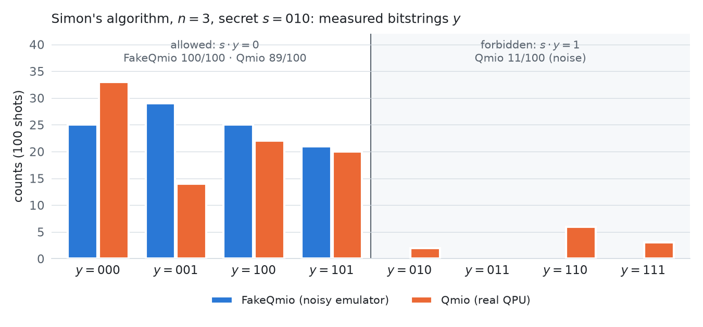

# Simon's algorithm on a real quantum computer (Qmio, CESGA)

*El algoritmo de Simon en Qmio, el ordenador cuántico del CESGA*

**Mario Córdoba Burgueño** · [LinkedIn](https://www.linkedin.com/in/mariocordobaburgueno/) 
*Jornada de Introducción a la Computación Cuántica* (Quantum Spain, TalentQ, CESGA and Estudiantes RSEF Madrid-UCM), April 2026: hands-on session on solving Simon's problem in Python on CESGA's quantum computing infrastructure

---

## Summary

A hands-on session on the basic resources of quantum computing, ending with **Simon's algorithm**, the first quantum algorithm with an exponential speedup over its classical counterpart. The circuits are written in [**Qibo**](https://qibo.science/) and run on two backends of [CESGA](https://www.cesga.es/) (Centro de Supercomputación de Galicia):

- **FakeQmio**, an emulator of the Qmio hardware with its noise model and the real-time qubit calibrations;
- **Qmio**, CESGA's quantum computer based on superconducting qubits.

The notebook goes through four steps:

1. **Superposition.** One- and two-qubit states with $X$, $Z$ and $H$, shown in the computational basis, on the Bloch sphere and as measurement counts.
2. **Parallelism.** The Walsh–Hadamard gate $H^{\otimes n}$, which puts all $2^n$ basis states in an even superposition in one step.
3. **Interference.** The quantum coin: two Hadamards in a row bring $|0\rangle$ back to $|0\rangle$, because amplitudes add, not probabilities.
4. **Simon's algorithm.** Given $f:\{0,1\}^n \to \{0,1\}^n$ with a secret period $s$, so that $f(x) = f(x \oplus s)$, find $s$. Classically, by brute force, this takes a number of queries that grows like $2^n$. The quantum circuit $H^{\otimes n}\,U_f\,H^{\otimes n}$ returns bitstrings $y$ with $s \cdot y = 0 \pmod 2$, so a few runs give a linear system that fixes $s$ with $O(n)$ queries.

## Key results

<picture>
  <source media="(prefers-color-scheme: dark)" srcset="figures/simon_dark.png">
  
</picture>

- **Simon's algorithm recovers the secret on real hardware.** For $n = 3$ and a random secret $s = 010$, with 100 shots, every FakeQmio outcome satisfies $s \cdot y = 0$, and so do 89 of the 100 Qmio outcomes. The three most frequent non-zero bitstrings give $s = 010$ on both backends, which is the secret.
- **Noise is visible on Qmio.** With $H^{\otimes 3}$ (1000 shots) every outcome should appear about 125 times: FakeQmio gives between 103 and 139 counts, Qmio between 54 and 177. With $X \otimes H$ on two qubits only two outcomes are possible: FakeQmio puts 998 of 1000 shots there, Qmio 867.
- **The quantum coin is fair on the hardware too.** One Hadamard and a measurement on Qmio gave 520 heads and 480 tails.

## Repository contents

| File | What it is |
|---|---|
| [`notebook/simon_algorithm_qmio.ipynb`](notebook/simon_algorithm_qmio.ipynb) | The session notebook, with the outputs of my runs on FakeQmio and Qmio |
| [`certificate/`](certificate/Certificado_Jornada_Computacion_Cuantica_CESGA_Mario_Cordoba_Burgueno.pdf) | Certificate of participation, signed by Jaime Scharfausen Curiel (Quantum Spain), in Spanish |
| [`figures/make_simon_figure.py`](figures/make_simon_figure.py) | Script that draws the figure above from the notebook outputs |

## Running the notebook

The notebook ran on CESGA's servers. Besides [Qibo](https://qibo.science/) and Qiskit, it needs `qmiotools` (CESGA's interface to Qmio) and the organisers' helper module `macros/macro_tQ.py`, with access to the Qmio queue. None of these is included, so outside CESGA the notebook can be read, with its outputs, but not run.

## Credits and license

The notebook is the hands-on material of the session, by **Irais Bautista** (CESGA), **Javier Mas** (IGFAE-USC) and **Andrés Gómez** (CESGA), released under [CC BY-SA 4.0](https://creativecommons.org/licenses/by-sa/4.0/). The copy here keeps that license. Changes from the original: the logos, the title image and three diagrams of the original material are not included; the server logs in the outputs are shortened to the results; the empty challenge and quiz cells at the end are removed.
